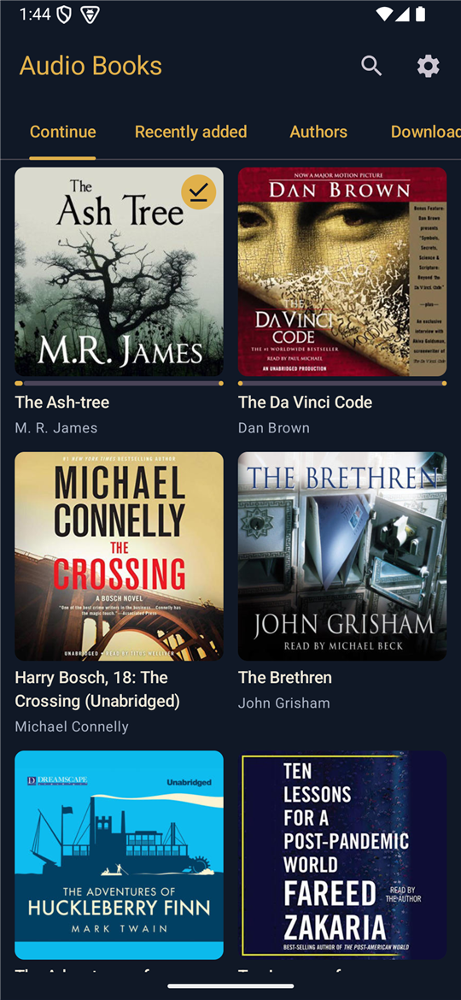
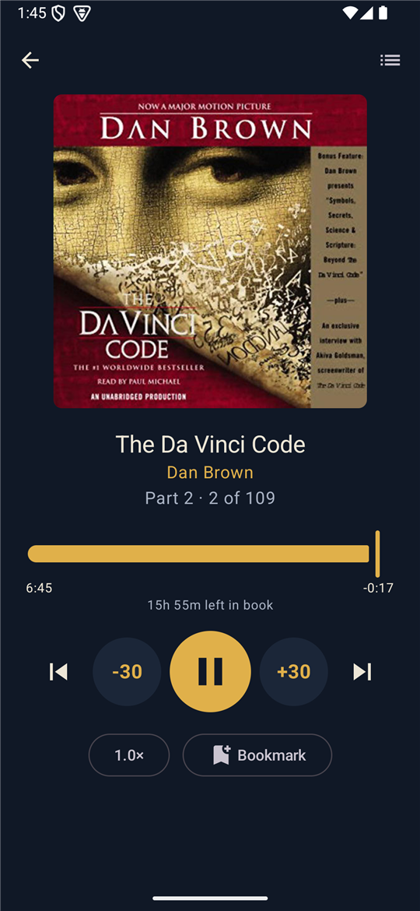
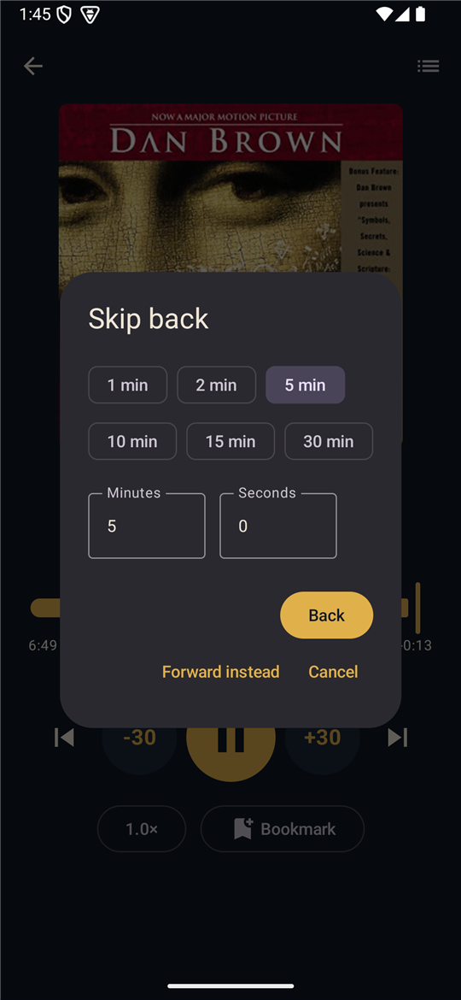
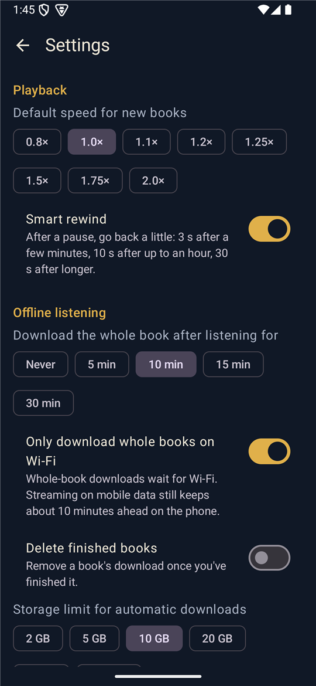

# LiberAudīre

An Android audiobook player for your own Plex server, built for the car and for places with no signal. *Liber* is Latin for "book" (and "free"), *audīre* "to hear".

- Plays the audiobooks on a Plex server you own or that is shared with you.
- Works in **Android Auto**.
- Keeps listening going **without signal**: it caches ahead while streaming, downloads whole books automatically, and lets you download books in advance.
- **Progress syncs with Plex**, so you can switch between LiberAudīre and other Plex apps.

LiberAudīre is an independent, free project. It is not affiliated with or endorsed by Plex.

| Library | Player | Hold to skip a custom amount | Offline settings |
|---|---|---|---|
|  |  |  |  |

## Install

1. Requires **Android 13 or newer**.
2. Download the latest `LiberAudire-x.y.z.apk` from the [Releases](https://github.com/Cd084/LiberAud-re/releases) page.
3. Open it on your phone. Android will ask you to allow installing apps from your browser or file manager.
4. Install updates the same way; your downloads and progress are kept.

## What you need on the Plex side

LiberAudīre reads audiobooks from a Plex **Music** library:

| Plex | LiberAudīre |
|---|---|
| Artist | Author |
| Album | Book |
| Track | Chapter (one audio file) |

- Books in one file (such as `.m4b`) and books split into many files both work.
- A library set up the common way for audiobooks in Plex works as it is: Music type, with the album artist as the author.
- To listen away from home, your server needs **Remote Access**, or the server owner's relay must be available.

## Features

**Plex**
- Sign in with your Plex account. LiberAudīre opens Plex's own sign-in page and never sees your password.
- Works for the server owner and for friends the server is shared with. Plex Home members can switch profiles, with PINs.
- Uses the best address for where you are: the home address on Wi-Fi, the remote one on mobile data. It switches automatically, even mid-book.
- **Progress syncs with Plex**, so other Plex apps resume where you left off. Progress made offline is sent when you're back online.
  - Plex itself doesn't store positions within the first minute of a file. LiberAudīre keeps those on the phone.
- LiberAudīre identifies itself to Plex as "LiberAudire", for example in the device list.

**Library**
- Tabs for Continue listening, Recently added, Authors, Downloaded and All books, plus search.
- Each book page shows the length, size, progress, chapters and bookmarks.
- Browsing works offline for books you've opened before; downloaded books are always available.

**Player**
- **−30 / +30** on a tap. **Hold either one to skip a custom amount**: quick choices from 1 to 30 minutes, or type minutes and seconds. The last custom amount is remembered.
  - The tap amounts can be changed in Settings. Skipping crosses from one file to the next.
- Previous and next chapter, and a chapter scrubber.
- Speed from 0.5× to 3×, remembered for each book.
- Bookmarks.
- **Smart rewind:** after a pause it goes back 3 s (after a few minutes), 10 s (up to an hour) or 30 s (longer).
- Lock screen, notification, Bluetooth and steering-wheel controls.

**Offline listening**
- **Streaming keeps about 10 minutes ahead on the phone**, so short dead zones don't interrupt you.
- **After 10 minutes of a book, the whole book downloads** automatically. The threshold can be changed or switched off.
  - "Only download whole books on Wi-Fi" (on by default) makes those downloads wait for Wi-Fi.
- **Download any book in advance** for planes and beaches. Books you download yourself never wait for Wi-Fi and are never removed to make room.
- A storage limit for automatic downloads (oldest removed first), optional deletion of finished books, and a button to clear the streaming cache.

**Android Auto**
- Browse Continue listening, Downloaded, Recently added and Authors on the car screen, with your skip amounts as buttons.
- Android Auto doesn't allow typing while driving, so custom skips are phone-only.
- Android Auto needs a one-time setting before LiberAudīre appears; see [Android Auto setup](#android-auto-setup).

## Android Auto setup

Android Auto only shows apps installed from the Play Store, unless you allow "unknown sources". You only need to do this once, on the phone:

1. **Open Android Auto's settings.** On most phones this is in **Settings → Connected devices → Connection preferences → Android Auto**. You can also search Settings for "Android Auto". On older phones, open the Android Auto app.
2. **Turn on developer mode.** Scroll to the bottom and tap **Version** (sometimes "Version and permission info") about 10 times, until a dialog asks whether to allow development settings. Tap **OK**.
3. **Allow unknown sources.** Open the **⋮** menu at the top right, then **Developer settings**. Scroll down and tick **Unknown sources**.
4. **Reconnect to the car.** Unplug the phone and plug it back in, or turn the car off and on. LiberAudīre then appears with the other media apps.

If it still doesn't show:
- In Android Auto's settings, open **Customise launcher** and make sure LiberAudīre is ticked.
- Restart the phone.
- Open LiberAudīre on the phone once and sign in before connecting.

Developer mode in Android Auto only adds a menu; it doesn't change how anything else works. Android Auto updates sometimes switch **Unknown sources** back off. If LiberAudīre disappears from the car, tick it again.

## Privacy

- LiberAudīre talks only to **plex.tv**, for sign-in and finding your servers, and to **your Plex server**.
- There are no ads, no analytics and no tracking.
- Your Plex sign-in, progress, bookmarks and downloads stay on the phone and on your Plex server.

## Known limitations

- **Single-file books show as one chapter.** Plex doesn't pass on the chapter marks inside `.m4b` files yet; reading them directly is planned. Skipping, bookmarks and resuming all work normally.
- **No sleep timer yet.**

## Problems and ideas

Please [open an issue](https://github.com/Cd084/LiberAud-re/issues). Include:
- your phone and Android version;
- what you did, what you expected, and what happened instead.

## Building

You need JDK 17 or newer, and the Android SDK with platform 37.1:

```sh
./gradlew assembleDebug      # app/build/outputs/apk/debug/app-debug.apk
./gradlew assembleRelease    # signed with the key named in key.properties, otherwise the debug key
```

`key.properties` (not in git) holds `storeFile`, `storePassword`, `keyAlias` and `keyPassword` for your own signing key.

| Path | Purpose |
|---|---|
| `plex/Plex.kt` | plex.tv sign-in, servers, Plex Home; library, books, progress reports |
| `App.kt` | Shared pieces: audio cache, downloads, network watching, progress sync, resume logic |
| `playback/PlaybackService.kt` | Background player (Media3), Android Auto browse tree, progress saving, the 10-minute rule |
| `playback/BookPlayer.kt` | Skip amounts, skipping across files, smart rewind |
| `playback/Downloads.kt` | Book downloads, waiting for Wi-Fi, storage limit, clean-up |
| `data/` | Settings, progress, bookmarks, download list, saved book details |
| `ui/` | Screens (Jetpack Compose) |

**Releases (maintainer):** bump `versionName`/`versionCode` in `app/build.gradle.kts`, add a `CHANGELOG.md` entry, then push a tag such as `v0.2.0`. GitHub Actions builds the signed APK and attaches it to the release.

## Licence

Copyright © 2026 Cd084.

LiberAudīre is free software: you can share and change it under the terms of the [GNU General Public License v3.0](LICENSE). If you distribute a modified version, you must make its source code available under the same licence. It comes with no warranty.
